# Evidencia digital en servicios cloud y dispositivos móviles

```toc
```

## Una evidencia repartida entre varios actores

En las lecciones anteriores la evidencia estaba contenida en un equipo, una captura de red o una base de datos entregada. En cloud y móvil, una misma acción puede dejar rastros repartidos entre el proveedor, el sistema de identidad, el dispositivo, la red corporativa y aplicaciones de terceros.

La pregunta ya no es solo cómo copiar un archivo:

> ¿Qué debe preservarse primero, quién controla cada fuente, cómo se demuestra que varias fuentes describen la misma acción y qué limitaciones impiden atribuirla a una persona?

Cuatro ideas ordenan la lección:

1. **preservar no es adquirir**: pedir al proveedor que retenga información evita que se elimine, pero no significa que ya haya sido entregada;
2. **cloud y móvil son fuentes complementarias**: el proveedor registra acciones del servicio; el dispositivo conserva artefactos locales seleccionados;
3. **el método determina el alcance**: una adquisición lógica no equivale a una imagen física ni promete datos borrados;
4. **cuenta, sesión, dispositivo y persona no son sinónimos**: la correlación técnica puede unir los tres primeros, pero la atribución personal necesita evidencia adicional.

El trabajo sigue una secuencia en la que cada etapa deja registro antes de pasar a la siguiente:

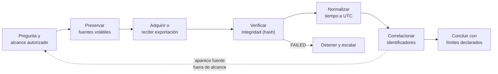

## 1. Qué cambia en cloud

La computación cloud separa la ubicación física de los recursos de la forma en que el usuario los consume. Una organización puede administrar cuentas, datos y configuraciones sin controlar los discos, hipervisores o registros internos del proveedor.

| Entorno | La organización controla principalmente | El proveedor controla principalmente | Consecuencia forense |
| --- | --- | --- | --- |
| SaaS | Usuarios, permisos, configuración y datos ingresados | Aplicación, plataforma e infraestructura | La evidencia suele obtenerse mediante consola, API, exportación o solicitud al proveedor |
| PaaS | Aplicaciones propias, datos e identidades | Sistema operativo, ejecución e infraestructura | Se combinan registros de la aplicación con telemetría de la plataforma |
| IaaS | Sistemas operativos invitados, aplicaciones, datos y parte de la red virtual | Infraestructura física e hipervisor | Puede haber snapshots y registros controlados por el cliente, pero no acceso al hardware físico |

La distribución exacta depende del contrato, del servicio y de su configuración. La expresión **responsabilidad compartida** no reemplaza la lectura del acuerdo: indica que ninguna de las partes posee por sí sola toda la evidencia.

### El modelo de despliegue también importa

| Modelo | Dificultad característica |
| --- | --- |
| Nube pública | Recursos multicliente, regiones distintas y dependencia del proveedor |
| Nube privada | Mayor control técnico, pero los registros pueden estar repartidos entre varios equipos internos |
| Nube híbrida | Una acción atraviesa sistemas locales y cloud con relojes e identificadores diferentes |
| Múltiples proveedores | Cada servicio usa formatos, retenciones, zonas horarias y mecanismos de exportación distintos |

No se debe escribir «la nube contiene el archivo». Hay que identificar el servicio, la cuenta o tenant, la región, el objeto, la versión y la fuente que registra la acción.

## 2. Actores, control y responsabilidad

Un plan de adquisición necesita responder quién puede autorizar, ejecutar, entregar y explicar cada fuente.

| Actor | Responsabilidad posible | Evidencia que puede aportar |
| --- | --- | --- |
| Propietario de la información | Define propósito, alcance y autorización | Identificación del caso, criterios de necesidad y límites |
| Administrador de identidad | Conserva cuentas, MFA, sesiones y cambios de privilegio | Registros de autenticación y directorio |
| Administrador cloud | Ejecuta exportaciones permitidas y documenta configuración | Auditoría, configuración, inventario, objetos y snapshots |
| Proveedor | Conserva o divulga datos que el cliente no controla | Registros internos, metadatos, confirmaciones de preservación |
| Administrador MDM | Relaciona dispositivos con organización, usuario y estado | Inventario, asignación, versión, cumplimiento e IP reportada |
| Especialista forense | Recibe, verifica, adquiere o analiza dentro del alcance | Hashes, bitácora, herramientas, consultas y resultados |
| Asesoría jurídica o autoridad competente | Define base legal, jurisdicción y solicitudes formales | Autorización, orden, alcance y condiciones de divulgación |

Una misma persona puede cumplir varios roles en una organización pequeña, pero la bitácora conserva las funciones: **quién autorizó**, **quién ejecutó** y **quién recibió**.

## 3. Fuentes de evidencia cloud

Una sola acción —compartir un archivo desde el teléfono— deja rastros en lugares controlados por actores distintos:

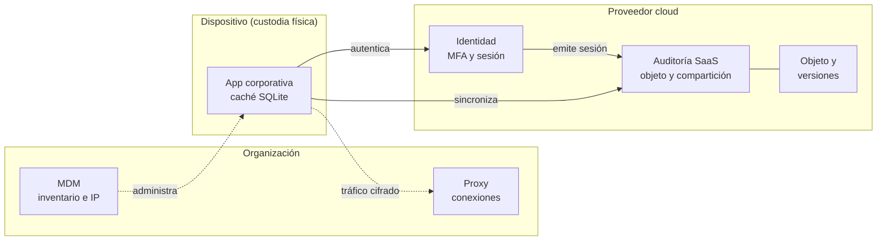

Cada caja tiene su propio responsable, retención, zona horaria y formato. Por eso el plan de adquisición se organiza **por fuente**, no por «la nube».

| Fuente | Qué puede mostrar | Identificadores útiles | Límite principal |
| --- | --- | --- | --- |
| Auditoría del servicio SaaS | Inicio de sesión, apertura, descarga, modificación o compartición | `event_id`, `session_id`, `object_id`, `share_id` | Registra lo que el proveedor decidió exponer y por el período retenido |
| Proveedor de identidad | Autenticación, MFA, emisión de sesión, dispositivo e IP | Cuenta, sesión, `device_id`, IP | Una autenticación válida no identifica físicamente a quien usó la cuenta |
| Inventario y configuración | Recursos, permisos, regiones, políticas y cambios | ID de recurso, tenant, grupo, rol | Suele mostrar el estado actual; la historia depende de auditoría o versiones |
| Objeto y versiones | Contenido, tamaño, hash, propietario lógico y fechas | `object_id`, versión, hash | Los metadatos del proveedor no demuestran por sí solos autoría |
| Snapshot | Estado de un volumen o instancia en un momento | ID de snapshot, volumen e instancia | No equivale necesariamente a apagar el sistema ni captura servicios externos |
| Red cloud o corporativa | Conexiones, flujos, destinos y volúmenes | IP, puerto, sesión o flujo | Con cifrado puede demostrar conexión, no contenido ni acción específica |
| Facturación y uso de API | Consumo de recursos y llamadas administrativas | Cuenta, proyecto, clave o solicitud | Está orientada a operación; puede resumir o agrupar eventos |
| Endpoint sincronizado | Caché, archivos descargados y registros del cliente | Cuenta, objeto, ruta, hash | Solo conserva lo sincronizado y puede cambiar al conectarse nuevamente |

### La ausencia de un evento

«No aparece en la exportación» no equivale a «no ocurrió». Antes de interpretar una ausencia se comprueba:

- ventana temporal y zona horaria consultadas;
- servicio, cuenta, tenant, región y proyecto correctos;
- filtros y campos de la consulta;
- paginación completa de la API;
- nivel de licencia o auditoría habilitado;
- período de retención y posibles retrasos de ingestión;
- errores, truncamiento o límites de la exportación.

## 4. Preservar antes de que la fuente desaparezca

Las fuentes cloud son dinámicas. Un registro puede rotar, una sesión expirar, un objeto cambiar de versión o un teléfono recibir instrucciones remotas.

Una prioridad práctica combina tres factores:

| Factor | Pregunta |
| --- | --- |
| Volatilidad | ¿Cuánto tiempo seguirá existiendo esta fuente sin intervenir? |
| Acceso | ¿La organización puede obtenerla o depende de un proveedor o autoridad? |
| Valor probatorio | ¿Qué pregunta del caso permite responder y con qué precisión? |

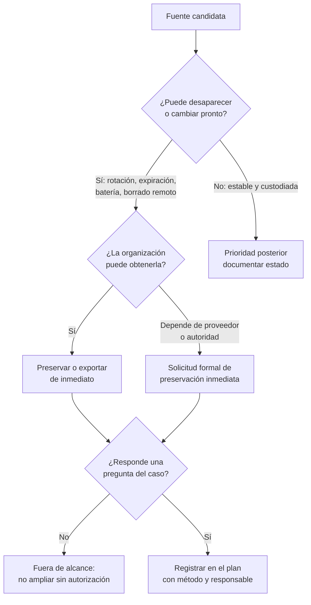

El resultado no es una regla universal de «más volátil primero». Si un registro SaaS expira en horas y el dispositivo está estable y custodiado, la preservación del registro puede ser prioritaria. Si el teléfono está encendido, desbloqueado y a punto de quedarse sin batería, su estado puede exigir atención inmediata por personal capacitado.

### Preservación, adquisición y divulgación

| Acción | Propósito | Qué no significa |
| --- | --- | --- |
| Solicitud de preservación | Evitar que datos identificados se eliminen durante un período | Que los datos ya fueron entregados o que su contenido está validado |
| Exportación del cliente | Obtener lo accesible mediante consola o API autorizada | Que incluye fuentes internas del proveedor o todo el período |
| Divulgación del proveedor | Entregar datos bajo el proceso contractual o legal aplicable | Que su interpretación sea automática o que no existan campos omitidos |
| Adquisición forense | Recoger y documentar datos mediante un método definido | Que el método capture todo lo que alguna vez existió |

El comprobante de preservación debe registrar al menos proveedor, cuenta u objeto, intervalo, identificador de solicitud, fecha, alcance y respuesta. Luego se conserva separado del paquete recibido: acredita una gestión, no el contenido de la evidencia.

Los estados de una fuente que depende del proveedor son distintos y cada transición deja un documento:

```mermaid
stateDiagram-v2
    direction LR
    Identificada: Fuente identificada
    Preservada: Preservada<br/>comprobante del proveedor
    Solicitada: Divulgación solicitada<br/>canal contractual o legal
    Recibida: Recibida<br/>hash al recibir
    Verificada: Verificada y analizada<br/>límites declarados
    [*] --> Identificada
    Identificada --> Preservada: solicitud de preservación
    Preservada --> Solicitada: base legal o contractual
    Solicitada --> Recibida: entrega del paquete
    Recibida --> Verificada: hash, formato, completitud
    Preservada --> Identificada: vence el plazo sin divulgar
```

El estado «Preservada» suele tener un **plazo**. Si vence sin que se haya solicitado la divulgación, la fuente puede volver a estar expuesta a eliminación.

## 5. Diseñar una adquisición cloud reproducible

Un plan mínimo debe declarar:

| Campo | Pregunta que responde |
| --- | --- |
| Pregunta del caso | ¿Qué se intenta establecer? |
| Alcance | ¿Qué cuentas, objetos, servicios e intervalo se incluyen y cuáles se excluyen? |
| Fuente y prioridad | ¿Qué se obtiene primero y por qué? |
| Método | ¿Consola, API, exportación, snapshot o solicitud al proveedor? |
| Responsable | ¿Quién autoriza, ejecuta, recibe y custodia? |
| Parámetros | ¿Qué filtros, zona horaria, versión de API y paginación se usaron? |
| Integridad | ¿Cómo se identifica el paquete y cuándo se calcula su hash? |
| Trazabilidad | ¿Qué fecha, herramienta, cuenta administrativa y acciones se registran? |
| Limitaciones | ¿Qué no entrega el método o qué depende del proveedor? |
| Contingencia | ¿Qué se hará si expira el registro, falla la API o el proveedor no responde? |

### Integridad de una exportación

El SHA-256 calculado al recibir una exportación permite comprobar que **esa copia** no cambió durante el análisis. No demuestra que el proveedor haya exportado todo, que el registro sea verdadero ni que la acción sea atribuible a una persona. Esas preguntas se responden con documentación del método, configuración, corroboración y límites.

En fuentes dinámicas puede no existir un hash previo calculado en el origen. Por eso se documenta el momento exacto de exportación, sus parámetros y el hash desde la recepción.

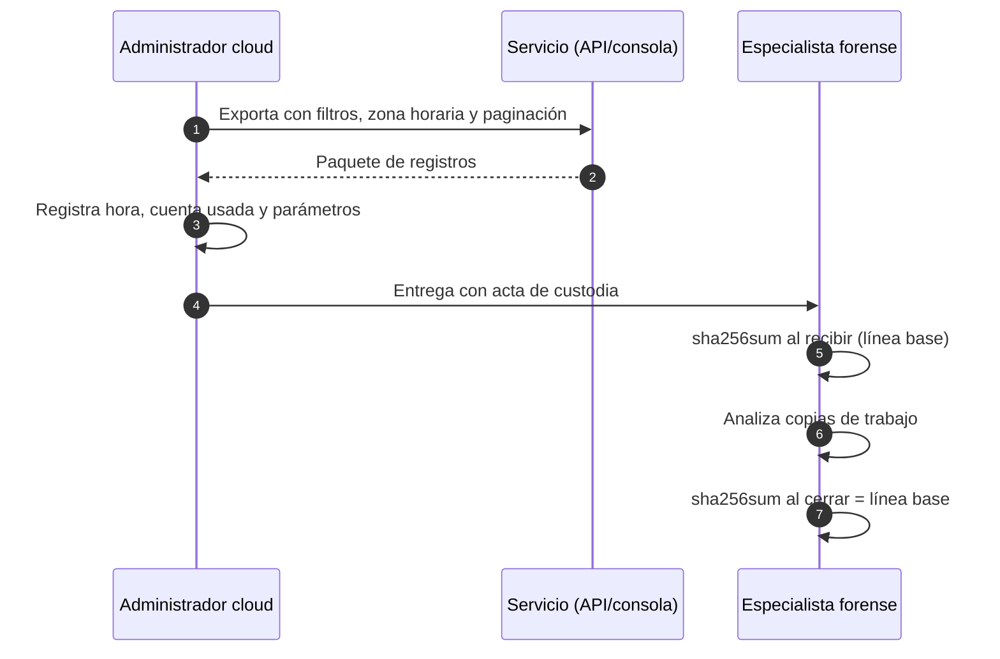

El hash protege el tramo **desde la recepción** hacia adelante. Lo que ocurrió antes (qué filtros se usaron, si faltaron páginas) solo lo cubre la documentación del plan: parámetros, trazabilidad y limitaciones.

## 6. El dispositivo móvil como fuente cambiante

Un teléfono es al mismo tiempo almacenamiento, sensor, autenticador y terminal de servicios cloud. Su estado puede cambiar con una notificación, una sincronización, un reinicio, una conexión de red o el agotamiento de la batería.

Al recibirlo se documenta, sin exploración innecesaria:

- marca, modelo, identificadores visibles y accesorios;
- estado de encendido, bloqueo, pantalla y batería;
- fecha y hora que muestra, sin corregirla;
- conexiones visibles y cambios observados;
- condición física y fotografías;
- persona que entrega, persona que recibe y hora;
- decisiones de aislamiento y su justificación.

### Aislar implica una decisión

Mantener conectividad puede permitir sincronización, modificación o borrado remoto. Interrumpirla puede hacer perder sesiones, provocar consumo de batería o impedir una adquisición que dependía del estado actual. Activar manualmente modo avión también altera el dispositivo y puede exigir desbloquearlo.

No existe una acción universal válida para todos los equipos. La decisión depende del estado, autorización, modelo, experiencia disponible y procedimiento de la organización. Se minimiza la manipulación y se documenta cada cambio.

El diagrama no indica qué hacer con un modelo concreto; muestra **qué debe quedar documentado** antes de que personal capacitado decida:

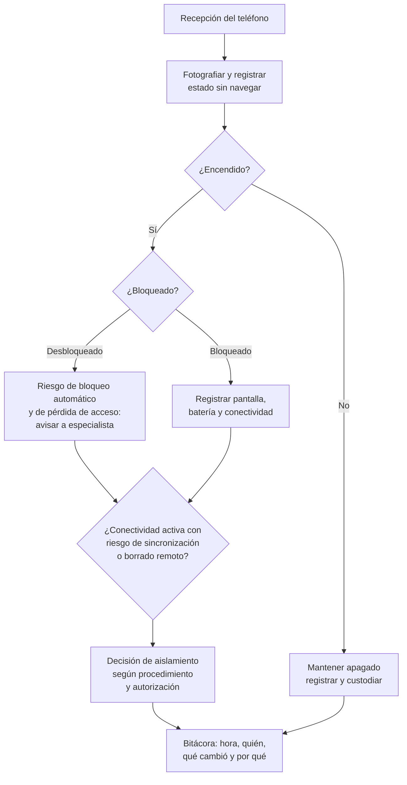

| Decisión | Beneficio | Costo forense |
| --- | --- | --- |
| Mantener conectado | Conserva sesiones y estado actual | Sincronización, notificaciones nuevas o borrado remoto |
| Aislar en bolsa o contenedor de blindaje de señal | Bloquea comunicación sin tocar la pantalla | Mayor consumo de batería; el equipo puede reiniciarse al agotarse |
| Activar modo avión | Corta la red de forma explícita | Exige interactuar y quizá desbloquear; queda registrado como cambio |
| Apagar | Detiene cambios inmediatos | Puede activar cifrado en reposo y perder datos solo disponibles encendido |

## 7. Métodos de adquisición móvil

| Método | Qué obtiene en términos generales | Ventaja | Límite que debe declararse |
| --- | --- | --- | --- |
| Documentación manual | Lo visible en pantalla mediante observación y fotografías | Puede conservar información inmediatamente accesible | Es selectiva, lenta y modifica el estado al navegar |
| Lógica, respaldo o API | Datos que el sistema o una aplicación permiten exportar | Menor intervención y estructura interpretable | No incluye necesariamente memoria completa, áreas protegidas ni datos borrados |
| Sistema de archivos | Archivos y metadatos accesibles mediante un método compatible | Más estructura y contexto que una exportación lógica limitada | Cobertura variable según modelo, versión, cifrado y permisos |
| Física o de bajo nivel | Representación amplia del almacenamiento por un método compatible | Puede ofrecer datos no disponibles por vías lógicas | Cifrado, hardware y versión pueden impedir interpretar o adquirir; exige personal y validación especializados |

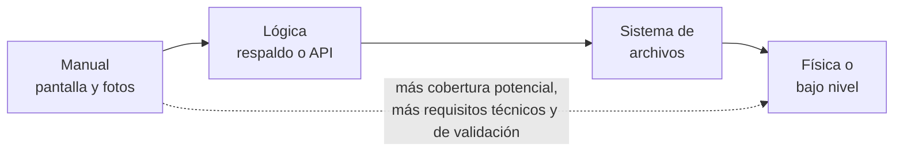

Moverse hacia la derecha **no garantiza** más datos: depende de que exista un método compatible con el modelo, la versión y el cifrado del dispositivo.

El nombre comercial de una herramienta no define la cobertura. Para cada adquisición se registra:

- método y modalidad exactos;
- herramienta y versión;
- modelo, sistema operativo y estado del dispositivo;
- inicio y fin;
- errores y elementos omitidos;
- archivos producidos y hashes;
- validación mediante fuentes o métodos independientes cuando sea posible.

### Qué significa «adquisición lógica seleccionada»

En la práctica de esta lección, `MOVIL-CASO04.sqlite` representa una adquisición lógica de una aplicación corporativa. Contiene tablas preparadas con información del dispositivo, metadatos de archivos, eventos de sincronización y caché de compartición.

Permite analizar esos artefactos. No permite afirmar que se adquirieron:

- todos los archivos del teléfono;
- memoria RAM;
- mensajes personales;
- otras aplicaciones;
- espacios no asignados;
- datos borrados.

## 8. SQLite y artefactos de aplicaciones móviles

Muchas aplicaciones conservan configuración y caché en SQLite. Una base puede contener objetos sincronizados, cuentas, sesiones, acciones pendientes y marcas de tiempo. También puede depender de archivos auxiliares `-wal` o `-shm`; si forman parte de una adquisición real, se preservan junto con la base.

En el laboratorio se recibe una base cerrada y autocontenida. Se consulta así:

```bash
sqlite3 -readonly -header -column \
  "file:/ruta/MOVIL-CASO04.sqlite?immutable=1" \
  "SELECT * FROM device_info;"
```

`-readonly` impide sentencias de escritura y `immutable=1` evita archivos auxiliares junto a la evidencia. La consulta sigue siendo una acción del análisis y se registra en la bitácora.

Antes de consultar datos conviene conocer la estructura:

```bash
sqlite3 -readonly "file:/ruta/MOVIL-CASO04.sqlite?immutable=1" ".tables"
sqlite3 -readonly "file:/ruta/MOVIL-CASO04.sqlite?immutable=1" ".schema files"
```

### El archivo WAL

En modo WAL (*write-ahead log*), SQLite escribe primero los cambios en `base.sqlite-wal` y luego los traslada a la base principal. En una adquisición real esto tiene dos consecuencias:

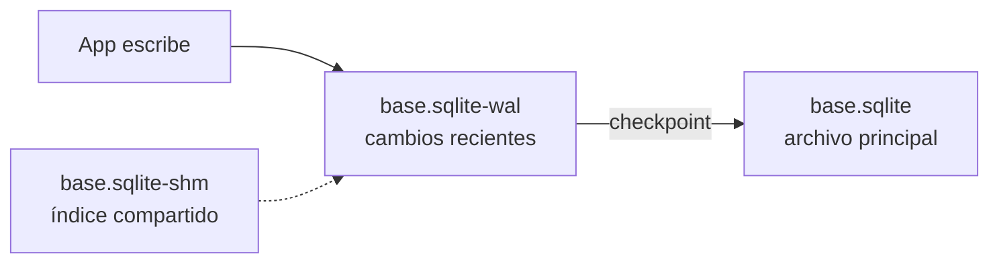

- si se copia solo `base.sqlite`, pueden faltar los cambios más recientes;
- si se abre la base sin protección, SQLite puede ejecutar un *checkpoint* y modificar el archivo principal.

Por eso se preservan los tres archivos juntos y se trabaja sobre copias. En el laboratorio la base ya viene consolidada y autocontenida.

### Formatos de tiempo en aplicaciones

Las aplicaciones no siempre guardan fechas legibles. Antes de interpretar una columna se identifica su formato:

| Formato | Unidad y origen | Ejemplo para `2026-09-03 14:05:42 UTC` | Conversión |
| --- | --- | --- | --- |
| ISO 8601 / RFC 3339 | Texto con `Z` o desfase | `2026-09-03T14:05:42Z` | Legible; verificar desfase |
| Unix epoch | Segundos desde 1970-01-01 UTC | `1788444342` | `date -u -d @1788444342` |
| Unix en milisegundos | Milisegundos desde 1970-01-01 UTC | `1788444342000` | Dividir por 1000 |
| Apple Cocoa / Mac absolute | Segundos desde 2001-01-01 UTC | `810137142` | Sumar `978307200` y tratar como Unix |

```bash
date -u -d @1788444342 '+%F %T UTC'
date -u -d @$((810137142 + 978307200)) '+%F %T UTC'
```

Un número de 13 dígitos suele indicar milisegundos; uno de 9 dígitos cercano a 800 millones puede ser Cocoa. Es una pista, no una regla: el formato se confirma con documentación de la aplicación o con un evento de hora conocida.

## 9. Tiempo e identificadores

Las fuentes del caso usan UTC (`Z`) y hora de Chile con desfase `-03:00`. Antes de ordenar eventos se normaliza todo a UTC.

```bash
date -u -d '2026-10-12T13:47:05.120-03:00' '+%F %T.%3N UTC'
```

El resultado es `2026-10-12 16:47:05.120 UTC`. El desfase ya está escrito en la hora: no se aplica una segunda conversión manual.

La fuerza de una correlación depende del dato de unión:

| Tipo | Unión | Ejemplo | Cuidado |
| --- | --- | --- | --- |
| Directa | Mismo identificador único | `session_id`, `object_id` o `share_id` en dos fuentes | Confirmar alcance y unicidad del identificador |
| Por valor | Mismo dato que puede repetirse | Hash, IP, nombre o tamaño | Puede coincidir por una causa distinta |
| Temporal | Solo cercanía de horas | Eventos separados por segundos | Sirve para buscar; por sí sola es débil para concluir |

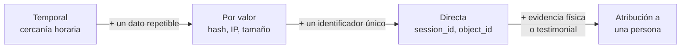

La flecha indica **fuerza creciente**, no un procedimiento: una unión temporal puede orientar la búsqueda, pero la conclusión se apoya en las uniones directas que se encuentren después.

### Diferencias de segundos entre fuentes

Dos fuentes pueden registrar la misma acción con horas que difieren en segundos. Las causas habituales son relojes no sincronizados, el momento en que cada sistema registra (inicio, fin o ingestión) y la latencia de red. Por eso:

- no se invierte el orden causal de dos eventos solo por una diferencia de 1 a 5 segundos entre fuentes distintas;
- se ordena dentro de cada fuente con su propio reloj y se comparan fuentes mediante identificadores;
- si el desfase es sistemático, se mide con un evento común y se declara.

### El hash une contenido, no autores

Si el objeto exportado y el metadato móvil tienen el mismo SHA-256, se sostiene que el valor calculado corresponde a los mismos bytes. El hash no demuestra:

- quién creó, abrió o compartió el archivo;
- desde qué fuente llegó originalmente;
- que dos nombres iguales tengan el mismo contenido si no se comparó el hash;
- que el archivo no haya existido en otras versiones.

## 10. Cuenta, sesión, dispositivo y persona

| Evidencia observada | Formulación acotada | Sobreafirmación |
| --- | --- | --- |
| Cuenta completa MFA | «La cuenta obtuvo una sesión tras MFA» | «La persona titular inició sesión» |
| Sesión aparece en SaaS y móvil | «Ambas fuentes registran la sesión X» | «El teléfono ejecutó físicamente cada evento» |
| MDM asigna un dispositivo | «El inventario asignaba el dispositivo a una cuenta o cargo» | «La persona lo tenía en la mano» |
| IP aparece en MDM y proxy | «El dispositivo reportó esa IP y el proxy registró una conexión» | «El proxy vio el archivo compartido» |
| Share ID aparece en móvil y SaaS | «Los artefactos se refieren a la misma compartición» | «La persona actuó con una intención determinada» |

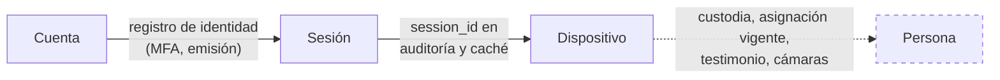

Los tramos sólidos se sostienen con registros técnicos; el tramo punteado exige evidencia de otra naturaleza.

Para acercarse a una atribución personal se buscan fuentes adicionales: registros del directorio y MFA, custodia física del dispositivo, asignación vigente, cámaras, testimonio, biometría cuando sea legalmente procedente o evidencia del endpoint. Incluso entonces se declara el grado de confianza y las explicaciones alternativas.

## 11. Alcance, privacidad y jurisdicción

Un dispositivo y una cuenta pueden contener información laboral y personal de terceros. La posibilidad técnica de obtenerla no constituye autorización.

El plan define:

- finalidad y pregunta investigativa;
- cuentas, aplicaciones, objetos e intervalo autorizados;
- minimización: recoger solo lo necesario;
- tratamiento de datos personales o privilegiados;
- regiones y jurisdicciones involucradas;
- retención y eliminación de copias de trabajo;
- responsables de aprobar una ampliación del alcance.

Si aparece una fuente relevante fuera del alcance, se preserva solo cuando exista autorización para ello o se escala. No se amplía silenciosamente la búsqueda.

## 12. Ejemplo resuelto - caso BAHÍA SERVICIOS (ficticio)

Una cuenta corporativa parece haber compartido `licitacion.pdf` con un dominio externo. La organización recibe cuatro fuentes verificadas:

| Fuente | Dato relevante |
| --- | --- |
| Identidad | La cuenta `l.rojas` completa MFA y recibe la sesión `S-82` desde la IP pública `198.51.100.24` |
| MDM | El dispositivo `MOB-18` estaba asignado al área comercial y reportó la IP local `10.4.8.17` |
| SaaS | La sesión `S-82` abre el objeto `O-551` y crea la compartición `SH-90` |
| Adquisición lógica | La aplicación conserva `S-82`, `O-551`, `SH-90` y el hash del archivo en su caché |

### Matriz de correlación

| Evidencia A | Evidencia B | Unión | Tipo | Conclusión acotada |
| --- | --- | --- | --- | --- |
| Identidad | SaaS | `S-82` | Directa | La sesión emitida a la cuenta aparece en la auditoría SaaS |
| SaaS | Adquisición lógica | `S-82`, `O-551`, `SH-90` | Directa | Ambas fuentes describen la misma sesión, objeto y compartición |
| Objeto exportado | Metadato móvil | SHA-256 | Por valor | El contenido comparado es idéntico en bytes |
| MDM | Proxy | `10.4.8.17` y ventana temporal | Por valor y temporal | El dispositivo reportó la IP que estableció conexiones al servicio |


### Cronología normalizada

Las horas siguientes son ilustrativas. El proxy registra en hora local y se convierte una sola vez a UTC:

| Hora original | Fuente | Hora UTC | Evento | Identificadores |
| --- | --- | --- | --- | --- |
| `2026-09-03T14:02:11Z` | Identidad | 14:02:11 | MFA completado y sesión emitida | `l.rojas`, `S-82` |
| `2026-09-03T11:05:39-03:00` | Proxy | 14:05:39 | Conexión cifrada al servicio | `10.4.8.17` |
| `2026-09-03T14:05:40Z` | SaaS | 14:05:40 | Apertura del objeto | `S-82`, `O-551` |
| `1788444342` (Unix) | Caché móvil | 14:05:42 | Sincronización local del objeto | `S-82`, `O-551` |
| `2026-09-03T14:08:58Z` | Caché móvil | 14:08:58 | Compartición preparada en la app | `SH-90` |
| `2026-09-03T14:09:03Z` | SaaS | 14:09:03 | Compartición creada con dominio externo | `S-82`, `SH-90` |

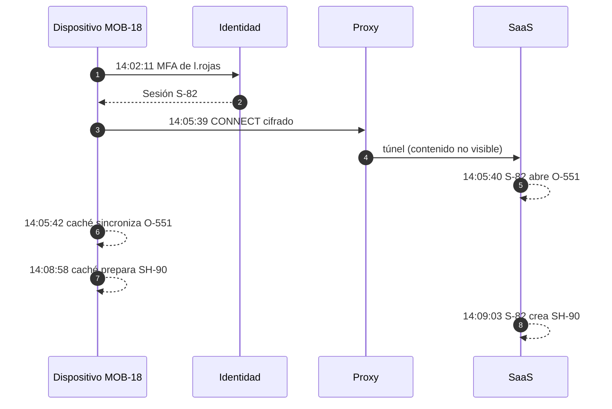

La diferencia de cinco segundos entre la preparación en el móvil y la creación en SaaS es coherente con una solicitud que viaja y se registra en otro sistema. La relación se sostiene por `SH-90` y `S-82`, no por la cercanía horaria.

### Conclusión de la etapa

> Las fuentes correlacionan la cuenta `l.rojas`, la sesión `S-82`, el dispositivo administrado `MOB-18`, el objeto `O-551` y la compartición `SH-90`. La coincidencia del hash vincula el contenido exportado con el metadato conservado por la aplicación. El proxy solo acredita conexiones al servicio, no el contenido cifrado. La evidencia permite describir acciones de una cuenta y una sesión; no identifica por sí sola a la persona que operó el dispositivo ni su intención.

### Plan que debió preceder la entrega

| Prioridad | Fuente y método | Responsable | Integridad y límite |
| ---: | --- | --- | --- |
| 1 | Preservar auditoría, objeto y versiones del SaaS para cuenta, objeto e intervalo definidos | Administrador cloud y proveedor | Registrar solicitud; preservación no equivale a entrega |
| 2 | Exportar identidad y MFA con sesión, IP y dispositivo | Administrador de identidad | Registrar filtros, zona y paginación; la cuenta no identifica a una persona |
| 3 | Custodiar y adquirir de forma compatible el dispositivo corporativo | Especialista autorizado | Documentar estado, método, versión y hash; declarar cobertura real |
| 4 | Exportar MDM y proxy para la misma ventana | Administradores MDM y red | Conservar líneas originales; una conexión no demuestra contenido |

## 13. La bitácora como evidencia del método

La bitácora permite que otra persona repita el análisis y llegue al mismo resultado. Cada entrada responde **cuándo, quién, qué, sobre qué, con qué y qué resultó**:

```text
2026-09-04 10:12 UTC | Equipo B | Consulta SQLite
  Evidencia: BAHIA-MOVIL.sqlite (SHA-256 verificado 10:02 UTC: OK)
  Comando:   sqlite3 -readonly ... "SELECT * FROM share_cache;"
  Resultado: 1 fila; share_id SH-90, object_id O-551 (fila id 3)
  Nota:      ts_utc en formato ISO con Z; no requiere conversión
```

| Una buena entrada | Una entrada insuficiente |
| --- | --- |
| Cita archivo y línea o tabla e `id` | «Se revisó la base» |
| Conserva el comando exacto | «Se buscó la sesión» |
| Separa observación de interpretación | «El usuario compartió el archivo» |
| Registra errores y resultados vacíos | Omite lo que no se encontró |

## 14. Errores frecuentes

| Error | Corrección |
| --- | --- |
| Pedir «todos los datos cloud» | Definir servicio, cuenta, objeto, región, intervalo y campos |
| Confundir preservación con entrega | Conservar comprobante y solicitar la divulgación por el canal aplicable |
| Suponer que la exportación es completa | Registrar filtros, paginación, licencia, retención y errores |
| Encender, apagar o navegar un teléfono por rutina | Documentar el estado y decidir con personal capacitado |
| Llamar «imagen física» a una exportación de aplicación | Nombrar el método y su cobertura real |
| Interpretar un hash como autoría | Limitarlo a igualdad de bytes |
| Comparar `-03:00` con `Z` sin convertir | Normalizar a UTC una sola vez |
| Atribuir la acción a la persona titular | Distinguir cuenta, sesión, dispositivo y persona |
| Inferir contenido desde un proxy cifrado | Usar SaaS o endpoint para la acción; proxy para la conexión |
| Ampliar el alcance al encontrar datos personales | Detenerse y escalar la autorización |
| Copiar solo `base.sqlite` sin `-wal` ni `-shm` | Preservar los tres archivos de la adquisición real |
| Leer un entero como fecha sin conocer su origen | Identificar el formato (Unix, milisegundos, Cocoa) antes de convertir |
| Reordenar eventos por diferencias de segundos entre fuentes | Unir por identificadores; declarar posibles desfases de reloj |

## 15. Preparación para la actividad

En la práctica se trabajará con `CLOUD-MOVIL-CASO04`. Conviene llegar con estas respuestas claras:

1. ¿Por qué una solicitud de preservación no demuestra que la evidencia ya fue entregada?
2. ¿Qué diferencia existe entre una adquisición lógica seleccionada y una imagen física?
3. ¿Qué puede demostrar una coincidencia de SHA-256 y qué no?
4. ¿Qué identificadores permiten unir identidad, SaaS y adquisición móvil?
5. ¿Por qué una dirección IP o una sesión no bastan para identificar a una persona?
6. ¿Qué limitación tiene un registro proxy frente a una conexión cifrada?
7. ¿Qué parámetros deben documentarse al exportar registros mediante API o consola?
8. ¿Qué debe contener un plan de adquisición para ser reproducible y acotado?
9. ¿Por qué una diferencia de pocos segundos entre fuentes no basta para invertir el orden de dos eventos?
10. ¿Qué riesgo existe al abrir una base SQLite con archivo WAL sin protección?

## 16. Glosario

| Término | Definición |
| --- | --- |
| Adquisición lógica | Obtención de datos que el sistema o una aplicación permiten exportar mediante interfaces compatibles. |
| Adquisición física | Método de bajo nivel orientado a representar ampliamente el almacenamiento; su alcance depende del dispositivo, cifrado y herramienta. |
| API | Interfaz mediante la que un programa solicita datos o acciones a un servicio. |
| Artefacto | Dato conservado por un sistema o aplicación que permite inferir una actividad. |
| Atribución | Vinculación de una acción con una persona determinada, sustentada en evidencia que va más allá de cuenta, sesión o dispositivo. |
| Cocoa time | Marca de tiempo de Apple expresada en segundos desde el 1 de enero de 2001 UTC. |
| Compartición | Permiso o enlace que concede acceso a un objeto a otra identidad. |
| Divulgación | Entrega de datos preservados mediante el proceso contractual o legal aplicable. |
| Forensic readiness | Preparación de sistemas, contratos y registros para que una investigación futura pueda obtener evidencia útil. |
| MDM | Sistema de gestión de dispositivos móviles que registra inventario, asignación, configuración y estado. |
| Objeto | Unidad de contenido de un servicio cloud, como un archivo, mensaje o registro. |
| Paginación | División de una respuesta de API en varias páginas que deben recorrerse para obtener el conjunto completo. |
| Preservación | Acción destinada a evitar la eliminación o modificación de una fuente identificada. |
| Responsabilidad compartida | Distribución de controles y obligaciones entre cliente y proveedor según servicio y contrato. |
| Sesión | Contexto temporal emitido después de una autenticación y usado para asociar acciones. |
| Snapshot | Copia del estado de un recurso, volumen o instancia en un momento definido. |
| Tenant | Espacio lógico de una organización dentro de un servicio compartido. |
| Unix epoch | Marca de tiempo expresada en segundos (o milisegundos) desde el 1 de enero de 1970 UTC. |
| UTC | Referencia horaria común para normalizar eventos de fuentes distintas. |
| WAL | *Write-ahead log* de SQLite: archivo auxiliar donde se escriben cambios antes de trasladarlos a la base principal. |

## Fuentes

- [NIST SP 800-201 - NIST Cloud Computing Forensic Reference Architecture](https://csrc.nist.gov/pubs/sp/800/201/final). Actores, capacidades, desafíos y preparación forense en ecosistemas cloud.
- [NISTIR 8006 - NIST Cloud Computing Forensic Science Challenges](https://csrc.nist.gov/pubs/ir/8006/final). Desafíos de arquitectura, recolección, tiempo, ubicación, análisis y dependencia del proveedor.
- [NIST Cloud Computing Forensic Science Project](https://csrc.nist.gov/projects/cloud-forensics). Publicaciones y recursos vigentes del proyecto de ciencia forense cloud.
- [NIST CFTT - Mobile Devices](https://www.nist.gov/itl/csd/secure-systems-and-applications/computer-forensics-tool-testing-program-cftt/cftt-7). Resultados y alcance de pruebas de herramientas de adquisición móvil.
- [NIST CFTT - Mobile Device Forensic Tool Test Specification v3.1](https://www.nist.gov/system/files/documents/2021/02/24/Mobile%20Device%20Forensic%20Tool%20Test%20Specification%20V%203.1.pdf). Requisitos y casos de prueba para adquisiciones lógicas, físicas y presentación de artefactos.
- [SWGDE 18-F-003-2.0 - Best Practices for Mobile Device Evidence Collection, Preservation, Handling and Acquisition](https://www.swgde.org/documents/published-complete-listing/18-f-003-2/). Preservación, manejo, documentación y adquisición de dispositivos móviles.
- [SWGDE - Best Practices for Mobile Device Forensic Analysis](https://www.swgde.org/documents/published-complete-listing/20-f-005-swgde-best-practices-for-mobile-device-forensic-analysis/). Análisis de artefactos obtenidos desde dispositivos móviles y límites de interpretación.
- [RFC 3339 - Date and Time on the Internet](https://www.rfc-editor.org/rfc/rfc3339). Formatos de fecha y hora con `Z` y desfases explícitos.
- [SQLite - Write-Ahead Logging](https://www.sqlite.org/wal.html). Funcionamiento de los archivos `-wal` y `-shm` y de los checkpoints.
- [SQLite - URI filenames (`immutable`)](https://www.sqlite.org/uri.html). Parámetros `mode=ro` e `immutable=1` para abrir bases sin modificarlas.

